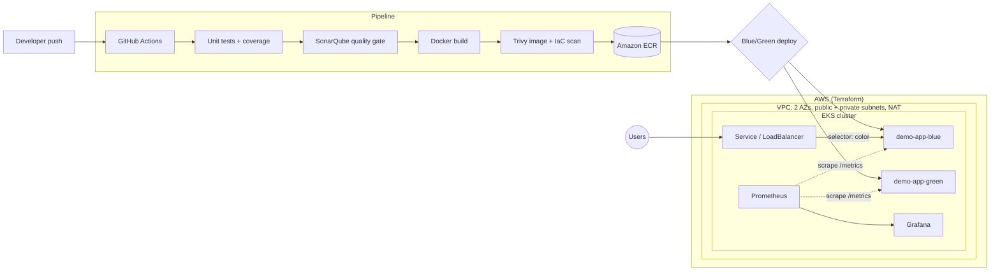

# Cloud-Native CI/CD Platform (AWS · Terraform · Kubernetes)

An end-to-end delivery platform: a containerised Node.js web app is tested, scanned and shipped to **Amazon EKS** through a **GitHub Actions** pipeline, using **Blue/Green** releases and monitored with **Prometheus and Grafana**. All AWS infrastructure is defined in **Terraform**.


## Architecture



## What's inside

| Path | What it does |
|---|---|
| `app/` | Express app with `/healthz`, `/readyz` and a Prometheus `/metrics` endpoint, Jest tests, multi-stage non-root Dockerfile |
| `terraform/` | VPC (2 AZs, private nodes, single NAT), EKS with managed node group, ECR with scan-on-push, GitHub OIDC provider and least-privilege deploy role |
| `k8s/` | Deployment template for each slot (probes, resource limits, hardened security context) and the Services |
| `scripts/blue-green-deploy.sh` | Deploys to the idle slot, waits for rollout, smoke-tests it, then switches the Service selector |
| `monitoring/` | kube-prometheus-stack values, ServiceMonitor and a Grafana "golden signals" dashboard |
| `.github/workflows/ci-cd.yml` | Test → SonarQube → build → Trivy → push to ECR → Blue/Green deploy |

## Pipeline

1. **Test**: Jest unit tests with an LCOV coverage report.
2. **SonarQube**: static analysis and quality gate (runs when the `SONAR_TOKEN` secret is set).
3. **Build**: multi-stage Docker image, runs as non-root, npm removed from the runtime layer.
4. **Trivy**: fails the build on fixable HIGH/CRITICAL image CVEs and also scans the Terraform and Kubernetes config.
5. **Push**: image tagged with the commit SHA and pushed to an immutable ECR repo.
6. **Blue/Green**: new version goes to the idle slot, is smoke-tested, then gets traffic. The old slot stays up for an instant rollback.

AWS access uses **OIDC**: there are no stored AWS keys in GitHub.

## Run it

### Prerequisites
AWS account, AWS CLI, Terraform ≥ 1.6, kubectl, Helm, Docker.

> ⚠️ **Cost:** EKS, the NAT gateway and the load balancer are billed hourly. Run `terraform destroy` when you finish.

### 1. Run the app locally
```bash
cd app
npm install && npm test
docker build -t demo-app .
docker run -p 3000:3000 demo-app   # http://localhost:3000
```

### 2. Provision AWS
```bash
cd terraform
cp terraform.tfvars.example terraform.tfvars
terraform init
terraform plan
terraform apply
$(terraform output -raw kubeconfig_command)
kubectl get nodes
```

### 3. Install monitoring
```bash
helm repo add prometheus-community https://prometheus-community.github.io/helm-charts
kubectl create namespace monitoring
kubectl apply -f monitoring/dashboard-configmap.yaml
helm install monitoring prometheus-community/kube-prometheus-stack \
  -n monitoring -f monitoring/values.yaml --set grafana.adminPassword='<choose-one>'
kubectl apply -f monitoring/servicemonitor.yaml
kubectl port-forward svc/monitoring-grafana 3000:80 -n monitoring
```

### 4. Turn on deployments
In the repo go to **Settings → Secrets and variables → Actions**:

| Type | Name | Value |
|---|---|---|
| Secret | `AWS_ROLE_ARN` | `terraform output github_actions_role_arn` |
| Secret | `SONAR_TOKEN` | token from SonarCloud (optional) |
| Variable | `DEPLOY_ENABLED` | `true` |
| Variable | `AWS_REGION` | `eu-west-2` |

Push to `main`. The pipeline deploys, and you can get the app URL with:
```bash
kubectl get svc demo-app -n demo
```

### 5. Roll back
```bash
kubectl patch svc demo-app -n demo -p '{"spec":{"selector":{"app":"demo-app","color":"blue"}}}'
```

### 6. Tear down
```bash
helm uninstall monitoring -n monitoring
kubectl delete namespace demo
cd terraform && terraform destroy
```

## Security decisions
- GitHub → AWS via OIDC, trust limited to `main` of this repo
- Deploy role can push to only this ECR repo and describe only this cluster
- Worker nodes in private subnets; pods run as non-root with a read-only root filesystem and all capabilities dropped
- Immutable image tags, ECR scan-on-push, and Trivy gating in CI
